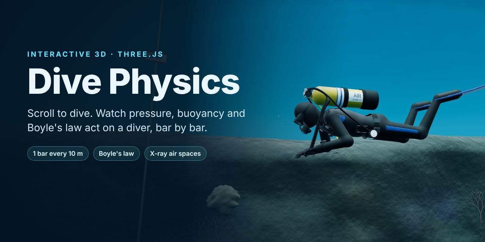
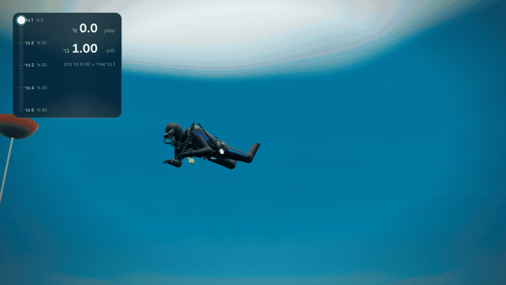
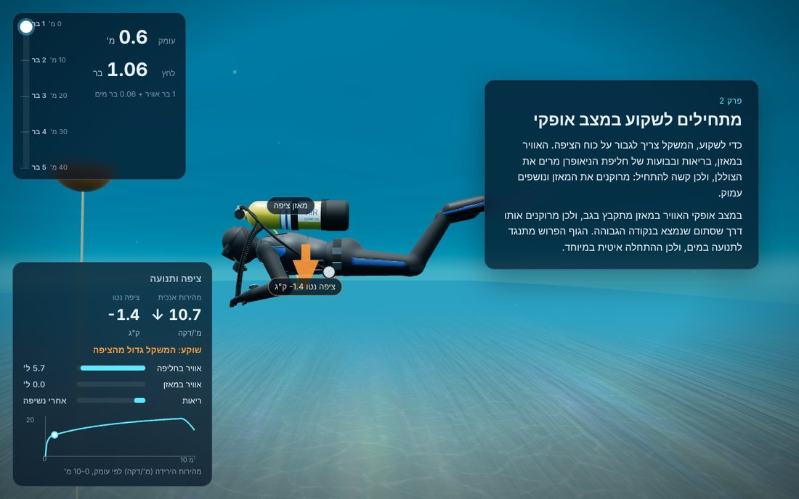
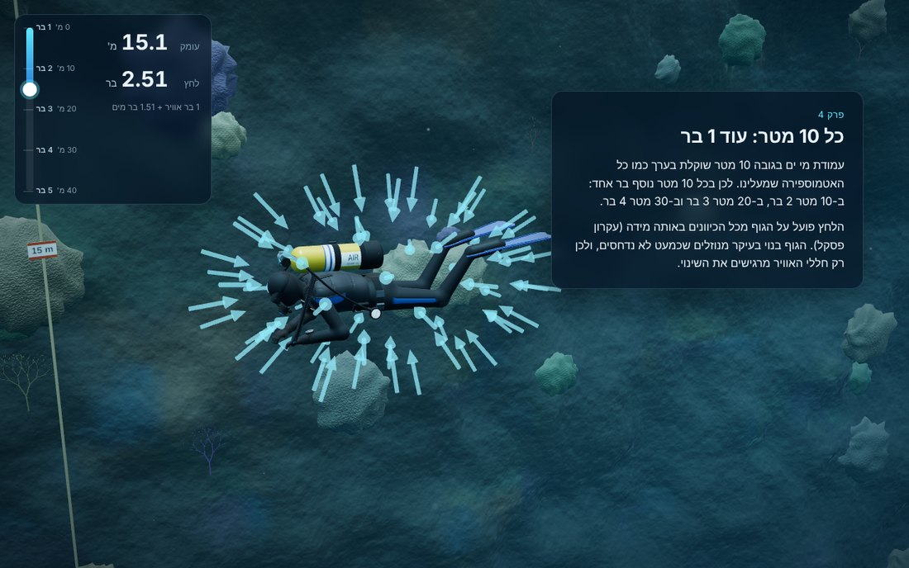
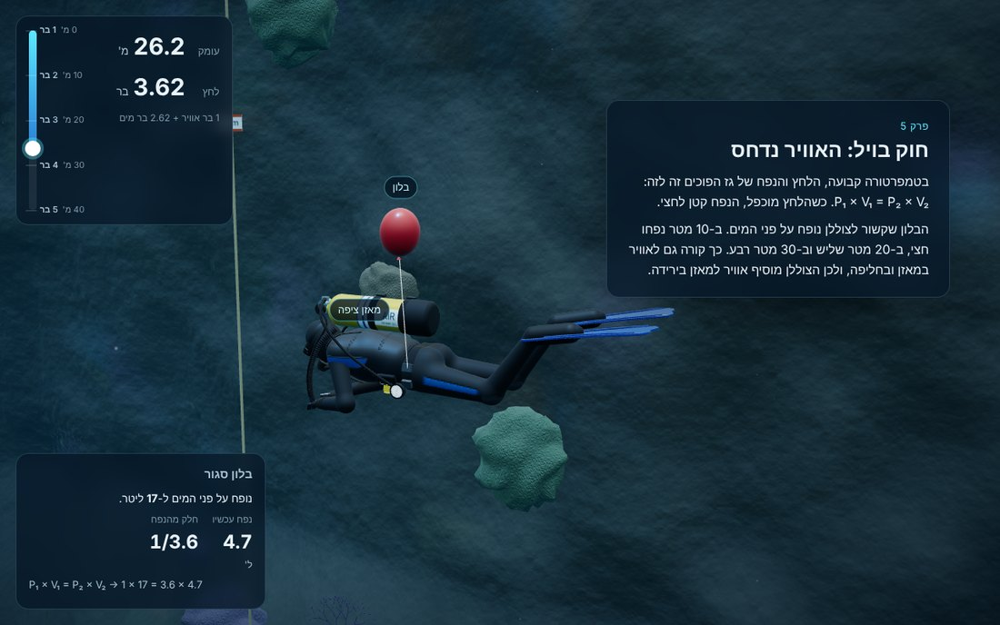
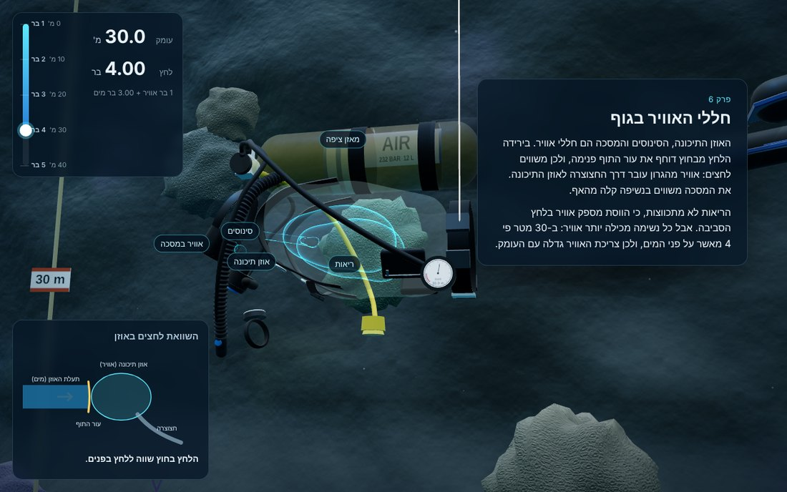
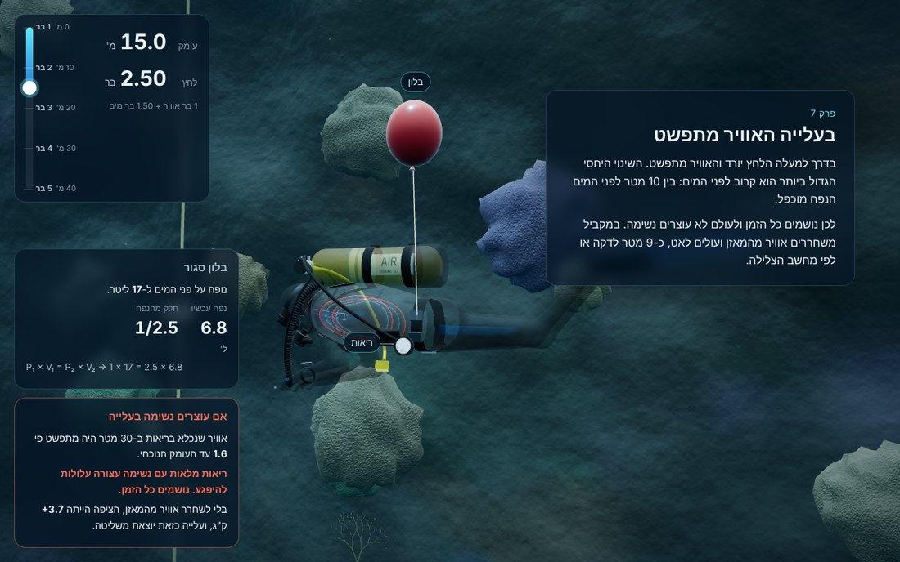
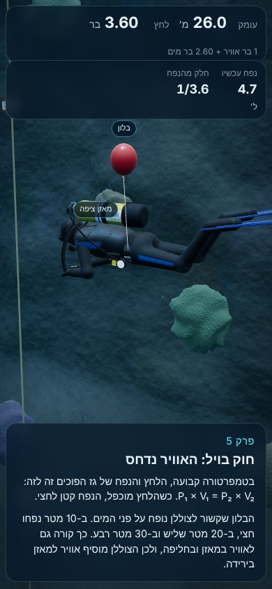
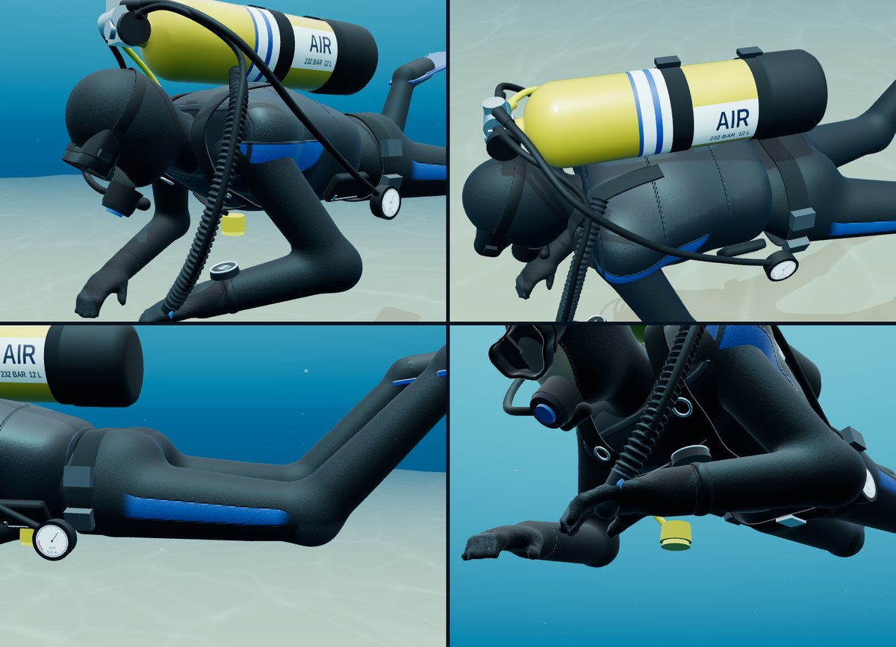
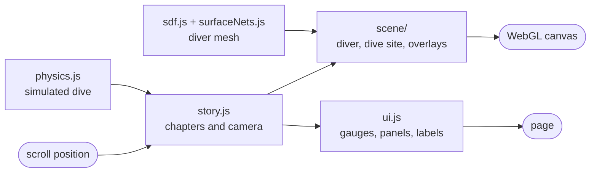

<p align="center">
  <a href="https://matnael332.github.io/dive-physics/">
    
  </a>
</p>

<p align="center">
  <a href="https://matnael332.github.io/dive-physics/"></a>
</p>

<p align="center">
  
  
  
  
</p>

<p align="center"><b>Scroll down and you dive.</b></p>

A diver sinks from the surface to 30 m and comes back up, and the page shows what the water does to him on the way: one more bar of pressure every 10 m, a wetsuit and BCD that lose buoyancy as they are squeezed, a balloon that shrinks by Boyle's law, and an X-ray view of the air spaces in the body. Everything is rendered live with three.js, and the diver himself is generated in code.

<p align="center">
  
</p>

## What you'll see

<table>
  <tr>
    <td width="50%" valign="top">
      <br>
      <b>A horizontal descent.</b> Vent the BCD, exhale and start to sink. A live panel shows net buoyancy, vertical speed and the gas in the suit, BCD and lungs, and the speed nearly doubles by 10 m.
    </td>
    <td width="50%" valign="top">
      <br>
      <b>One bar every 10 m.</b> Pressure arrows push on the diver from every direction (Pascal), growing with depth: 2 bar at 10 m, 3 at 20, 4 at 30.
    </td>
  </tr>
  <tr>
    <td width="50%" valign="top">
      <br>
      <b>Boyle's law.</b> A balloon filled with 17 L at the surface shrinks to ½, ⅓ and ¼ of its volume at 10, 20 and 30 m.
    </td>
    <td width="50%" valign="top">
      <br>
      <b>Air spaces in the body.</b> An X-ray view of the lungs, sinuses, middle ears, mask and BCD, and an animated diagram of equalizing the ears.
    </td>
  </tr>
  <tr>
    <td width="50%" valign="top">
      <br>
      <b>The ascent.</b> The balloon grows back. A warning shows how much trapped lung air would expand, and what a BCD that is not vented would do.
    </td>
    <td width="50%" valign="top" align="center">
      <br>
      <b>On phones too.</b> The layout moves the story to the bottom of the screen and keeps the diver in view.
    </td>
  </tr>
</table>

<details>
<summary><b>All eight chapters</b></summary>

1. **Surface, 1 bar.** The diver floats on his belly with some air in the BCD.
2. **Starting a horizontal descent.** Vent the BCD from its highest point and exhale; the spread-out body slows the start.
3. **The descent speeds up.** The suit is squeezed, buoyancy drops and the diver sinks faster, so he adds short bursts of air to the BCD.
4. **Every 10 m adds 1 bar.** Pressure acts equally from every direction.
5. **Boyle's law.** The balloon shrinks; so does the air in the BCD and the suit.
6. **Air spaces in the body.** Ears, sinuses and mask are equalized; the lungs keep their volume because the regulator delivers air at ambient pressure, so every breath holds more air.
7. **The ascent.** Air expands again, most of all near the surface. Breathe all the time and vent the BCD.
8. **Safety stop and surface.**

</details>

## A diver built in code

<p align="center">
  
</p>

No 3D model was downloaded. The body is a set of signed distance primitives (ellipsoids and tapered capsules) blended with a smooth minimum and turned into a mesh with surface nets when the page loads. Skin weights come from how close each primitive is, so the legs kick on a real skeleton. The scuba kit is built from lathes, sweeps and extrusions: tank with boot and label, valve and first stage, hoses with strain reliefs, a corrugated inflator, octopus, console, mask, weight belt and fins. The BCD is an offset of the torso with a morph target for inflation, and its straps, buckle, D-rings and pockets move with it. Wetsuit panels, seams, knee pads, gloves and the hood's face opening are drawn in the fragment shader from the bind-pose position, so their edges stay sharp.

## The physics

| Idea | Rule used in the simulation |
|---|---|
| Pressure | $P = 1 + \dfrac{d}{10}$ bar, with depth $d$ in metres |
| Boyle's law | $P_1 V_1 = P_2 V_2$ for a closed, flexible air space |
| Buoyancy | each litre of gas in the suit, BCD or lungs lifts about 1.025 kg of sea water |
| Drag | $F = \tfrac{1}{2}\,\rho\,C_d A\,v^2$, with a large area for a horizontal body |
| Light | red, green and blue fade at different rates with depth, so red disappears first |

`src/physics.js` simulates the whole dive from these rules, and the scroll position is a moment in that simulation. Every number is an approximation for learning; the site says so and does not replace a diving course or dive planning.

## How it works



- **Water:** fog and light that change with depth, caustics injected into the standard materials, a surface shader with Snell's window, light shafts, drifting particles, and exhaled bubbles that grow as they rise.
- **Privacy and safety:** no server and no requests, a strict Content Security Policy, and three.js bundled with esbuild into `dist/app.js`.
- **Accessibility:** the whole story is real text on the page, it still reads without WebGL, and it respects reduced motion.

## Run it locally

Open `index.html` in a browser. The bundle is committed, so no build step is needed to view it.

## Develop

```
npm install
npm run build   # bundles src/ into dist/app.js
npm test        # node:test unit tests
```

The 16 tests cover pressure and Boyle's law, buoyancy and drag, the simulated dive (story order, the descent speeding up, BCD air added on the way down and vented on the way up), the mesher (vertices on the surface, a closed mesh, outward winding), the diver's skeleton and proportions, the lungs sitting inside the chest, the chapter timeline and the page's security policy.

## Project structure

```
index.html            page and story text (Hebrew)
css/style.css         layout and theme
src/physics.js        pressure, buoyancy, drag and the simulated dive
src/story.js          what each chapter shows and where the camera looks
src/ui.js             gauges, panels, labels, ear diagram
src/sdf.js            distance primitives and blending
src/surfaceNets.js    mesher
src/diverShape.js     the diver's skeleton and body shape
src/scene/            three.js scene: diver, surface detail, dive site, overlays, materials
tests/                unit tests
docs/                 images for this page
```

## Roadmap

Next: air in the hoses and air consumption by depth, nitrogen in the blood, vision and colours under water, and a video export. Tested in Chromium; other browsers are not verified yet.

## Credits

Built with [three.js](https://threejs.org) (MIT licence); its notice is kept in `dist/app.js.LEGAL.txt`.
